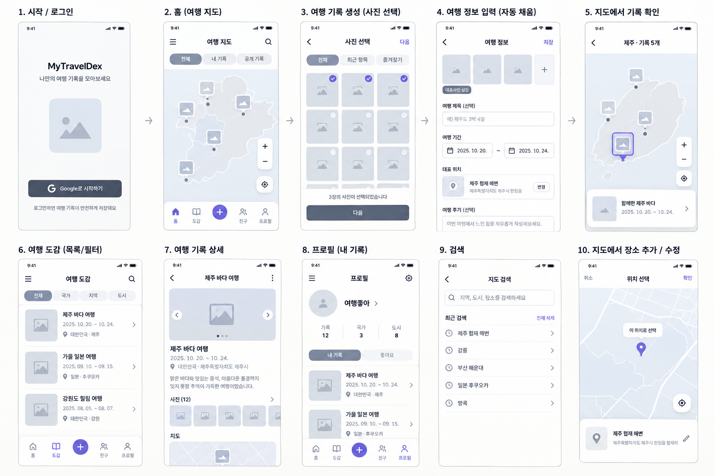

# 여행가봥 UI/UX 재설계 초안

## 실제 Figma 자산 적용 (2026-11-09)

기준은 FIGMA_IMPLEMENTATION의 Batch 매핑과 최신 대체 시안이다. 17A는 Batch02 6:34의 PNG 메뉴32/추가54·선택 민트면/진한글자/밑줄과 Batch01 2:46의 백팩/기본곰/바다 장식을 공통 컴포넌트에 적용한다. 원본 팔레트는 보존하며 스크린샷을 앱 화면으로 사용하지 않는다. min48·compact·글꼴 확대·작동 중 탭/입력 보존·동작 줄이기가 고정 시안의 높이보다 우선한다. 세부 테마/프로필의 최신 시안은 단계별로 적용한다.


## 간결한 compact shell·행동 반응 (2026-11-08)

대표사진의 접근성 이름은 유지하고, 웹은 RN Web이 생성하는 실제 img의 역할을 사용해 바깥 View에 같은 image 역할을 중복 지정하지 않는다. Android의 명시적 image 역할은 유지한다.

기존paper #EFFAFF/sheet #FFFFFF/warm #E9F8F1/coral #F59E8C/ink #4A3B32·시스템고딕/사진주인공방향을유지한다. 높이500 미만에서는 상단 영역 최소44px·탭 최소50px로 본문 공간을 확보하고 중복 탭 아이콘을 생략해 레이블과+동작을 우선한다. 폭은기존max1120/640rail를유지, 간격은12/16/20으로정리한다. 지도나사진에새장식을더하지않는다.

도감의검색어만지우기와명확한검색empty안내·필터선택상태를제공하고공통Feedback의누름/호버/키보드포커스와reduceMotion을재사용한다. 범위popup은짧은지도안에서스크롤하고하단탭/출처를보존한다. compact여부가검색/정렬/선택을초기화하지않는다.


## 유저 ID 명칭 (2026-11-08)

식별자를표시하는My/친구탭제목·접근성·placeholder·에러/재시도문구는“유저 ID”로통일한다. “내 친구 ID/내 친구 코드”표시는사용하지않는다. 영문대문자/숫자6자를선택가능텍스트로표시하고친구추가에사용함을설명한다. 카드/지도/배치변경없음.


## 산·풀 표시 제거 (2026-11-08)

산·풀은 선 표현도 포함해 지도에서 제거한다. 사진 썸네일/군집과 지역명을 시각적 중심으로 유지한다. 바다 장식·지도 색 원본·얕은 측면·출처는 유지한다. 이 절이 과거 산풀 추가/단순 선 표현 방향을 대체한다.


## My 친구 ID·전체 목록·단순 산풀 (2026-11-08)

My 프로필 첫 영역과 친구 탭에 6자리 숫자 ID를 선택가능한 텍스트로 표시한다. 친구 찾기는 전체 여행자 목록을 기본 표시하고 닉네임·짧은ID 검색/전체보기/새로고침·이전/다음 페이지를 기존 버튼/카드로 제공한다. 공개동의 범위를 설명하며 요청·수락 상태는 유지한다. 산은 윤곽/산등성이 한두 선, 풀은 줄기/잎 윤곽 선만 남기고 채움·면 음영을 제거한다. 실제 지역/마커와 기존 색 원본은 보존한다.

## 작성 위치 검색바 (2026-11-08)

기존 색상/여백을 유지하고 작성 화면의 위치 버튼을 테두리·돋보기·장소/주소 또는 빈 placeholder가 있는 전체폭 검색바로 교체한다. 입력형 외관이지만 별도 창을 여는 button 의미와 위치검색 접근성 이름/힌트, 최소48dp/키보드 동작을 제공한다. 촬영GPS가 있으면 원좌표를 즉시 표시하며 주소는 도착하면 보완한다. GPS가 없으면 검색바를 빈 안내로 두고 별도 LocationPicker의 검색 탭에서 직접 확정한다. 본문은 자동 생성하지 않는다.

## 사진 묶음 지도·검색 도감·추천 친구 (2026-11-08)

기존 하늘 #EFFAFF·민트 #E9F8F1·코랄 #F59E8C, 지도 바다 #A9DFFA·경계 pastel을 유지한다. 시스템 고딕 제목21/28·카드16·보조12~14, 왼쪽 정렬/8·12·20 여백을 재사용한다. 시각적 초점은 겹친 사진: 52dp 대표사진 뒤 최대2장의 회전 카드·그림자와 숫자 배지. 군집을 열면 제목/닫기→가로 썸네일 카드→구분선/빠른 여행 목록을 제한 높이 패널로 제공한다. 좁은 높이/큰 글꼴은 패널 안에서 스크롤하고 출처와 하단 탭은 보존한다. 동작은 사용자 선택에만 반응한다.

도감은 항상 보이는 검색창과 접힌 정렬 패널(시작일 최신순 기본, 과거순, 지역 가나다순/역순)로 입력 부담을 줄인다. 추천은 친구 탭의 검색 아래 별도 섹션·최대50명/새로고침·공개 닉네임/아바타/코드·명시적 요청으로 제공한다. 지도는 실제 행정 경계 아래 얕은 측면으로 떠 있는 종이 느낌, 지역 내부에 소수의 산/풀 고정 SVG 장식을 둔다. 실지형/산 위치를 표시하는 데이터가 아니며 접근성/터치를 가로채지 않는다. 사진과 지역명보다 작게, 줌9 이상·핀 보정에서 숨긴다. 원본 storyboard/palette는 보존한다.

## 간결한 여행 사진첩·반응 효과 개편 (2026-11-07)

사용자가 외부 웹/앱 참고 디자인 변경과 t14 반복 리뷰를 요청한 이번 개편의 기준이다. 원본 스토리보드·컬러 JSON·기록/친구 권한 계약을 유지한다. 실제 참고 화면은 [Polarsteps](https://www.polarsteps.com/)의 큰 여행 이미지·지도 중심 흐름, [Airbnb](https://www.airbnb.com/)의 사진 목록·필터 구조다. 외부 사진/로고를 앱 자산으로 복사하지 않는다. 아래 선택은 여행가봥에 맞춘 설계이며 다른 서비스의 정확한 구현 방식으로 주장하지 않는다.

- 색: 하늘 `#EFFAFF`, 종이 `#FFFFFF`, 민트 `#E9F8F1`, 코랄 `#F59E8C`, 본문 `#4A3B32`, 보조 `#5D6971`. 기존 의미 토큰을 사용하고 얇은 경계·한정된 그림자로 겹침만 구분한다.
- 글꼴: 기존 한국어 시스템 고딕. 화면 제목 28/굵게, 카드 제목 16/굵게, 본문 14~16, 보조 12~13. 글꼴 배율을 따른다. 왼쪽 정렬과 8/12/20/28 여백으로 사진 중심 위계를 만든다.
- 배치: 모바일은 지도를 채우고 폭이 제한된 하단 탐색 레일을 둔다. 도감은 제목→범위/필터 진입→사진 순서, 기간·지역 입력은 필터 패널에 접어둔다. 넓은 도감은 최대 1120dp/4열, 작은 폭·큰 글꼴은 1열까지 조절한다. 작성 패널은 최대 640dp, 미리보기는 넓은 화면에서도 실제 좁은 사진 카드 폭으로 제한한다.

```text
모바일                         넓은 화면
백팩 여행가봥 / 나만의 여행도감   백팩 여행가봥                 나만의 여행도감
지도 / 사진                     지도 또는 최대 1120dp의 여행 사진첩
범위 칩 / 사진 미리보기          2~4열 사진 / 제한된 폭의 패널
  홈 도감 + 친구 My                중앙에 모인 홈 도감 + 친구 My
```

장식용 카드를 여러 겹 추가하는 안은 사진·지도 공간을 줄이므로 제외한다. 기억할 시각 요소는 백팩과 실제 여행 사진이고 나머지는 조용하게 둔다. 효과는 행동에 반응한다: 버튼·사진·탭의 누름 약 0.975배/100ms, 포인터 호버 약 1.012배/140ms, 포커스 링, 패널 220ms, 미리보기 160ms. 자동 반복·배경 움직임은 추가하지 않는다. 동작 줄이기에서는 이동/크기를 생략하고 포커스·색상·문구 피드백을 유지한다. 효과 종료를 API 실행 조건으로 삼지 않는다.

친구 요청·UUID 코드·초대는 TRD의 2026-11-07 계약을 따르며 아래의 예전 일방 팔로우 전용 설명보다 우선한다. 데이터 흐름은 바꾸지 않고 공통 반응 표면과 폼·사진·패널의 시각 표현을 재사용한다. t14 리뷰는 최대 3회, 실제 검증/한계는 TEST_CASE와 DEVELOPMENT_STATUS에 기록한다.

출처 영역은 실제 레이아웃 높이를 지도에서 측정해 미리보기 아래에 확보한다. 글자 확대/줄바꿈에도 패널과 출처 사이를 최소 8dp 띄운다. 누름 효과 적용 전 최소 50dp를 보장해 0.975배로 눌러도 48dp 이상을 유지한다. 검증 스크린샷의 사진은 Mobius6의 CC BY-SA 4.0 [전주 fixture](../frontend/e2e/fixtures/README.md)이며 UI crop·앱 압축·해상도 축소를 적용했다. 앱 코드 라이선스와 사진/스크린샷 사진 부분의 라이선스는 구분한다.

## 밝은 파스텔 UI 개편 (2026-11-07)

기존 기능 계약을 유지하는 디자인 개편이다. 원본 팔레트/스토리보드는 보존하고 theme 의미 토큰으로 하늘 #EFFAFF·민트 #E9F8F1·기존 코랄을 확장한다. 홈 발자국 배지만 제거하고 My 스탬프는 유지한다. 네 지도 범위는 선택기 하나로 통합하고 로그인/계정은 My로 접근한다. 지역명은 상자/체크 없는 회색 글자로 줌 5~9에서 11~15로 변화하며 충돌과 글꼴 확대를 고려한다. 기존 17개 실제 경계 아래 얕은 그림자·구분 레이어를 추가하되 좌표/경계와 선택 강조는 보존한다.

지도 기록은 최대 화면 높이 60%의 하단 사진 패널로 열고 대표사진 우선 가로 갤러리, 작은 제목/날짜, 기존 content의 두 줄 한줄평을 보여준다. 상세에서 전체 내용과 같은 갤러리를 제공한다. 사진 순서/대표 지정/삭제/권한/서명 URL 재발급은 유지하고 관리 동작을 접어 정리한다. 사진 아래 이름은 숨기고 공개 동의된 기존 프로필 사진 또는 로컬 여행 캐릭터 SVG만 표시한다. 접근성 작성자 이름과 친구/My의 이름은 유지한다. 전체 화면과 시작 스플래시·로그인 진입은 밝은 테마로 통일한다.

반응형은 320~1280 폭·가로·fontScale 1/1.5/2, 안전 영역/키보드에 대응하며 최소 48dp 터치·일반 텍스트 대비 4.5:1을 유지한다. 사용자 반응에만 짧은 효과를 쓰고 동작 줄이기를 존중한다. API/DB/RLS/migration 변경 없이 기존 조회·사진 압축·Storage·OAuth·EXIF·초안·소유자 권한을 사용한다. 참고: [Polarsteps](https://www.polarsteps.com/), [Mapicus](https://www.mapicus.app/), [MapLibre layers](https://maplibre.org/maplibre-style-spec/layers/). 자동 및 Android 실제 검증 결과와 미검증 조건은 TEST_CASE 최신 이력을 따른다.

## 바다 배경·위치 비교 창 (2026-11-07)

지도 배경은 원본 팔레트의 파란 바다색으로 표시하고 물결·구름·비행기·배 조형을 바다 위에만 장식한다. 장식은 터치·접근성 탐색을 가로채지 않으며 확대 시 숨겨 실제 지형/랜드마크와 구분한다. 지리 좌표·축척·선택 레이어 갱신 계약은 유지한다.

위치 입력은 작성 패널의 위치 선택 버튼으로 별도 전체 창을 연다. 지도 선택/장소 검색을 제공하고 인증된 기존 Geoapify 검색→이름·실제 주소 목록→장소 상세 조회→후보 핀/주소 비교→이 위치로 선택 순서를 따른다. 확정 전에는 작성 중인 위치를 바꾸지 않는다. 닫기/뒤로/검색 실패는 사진·기간·위치를 보존하며 늦은 응답은 닫힌 창이나 새 후보를 덮어쓰지 않는다. 주소는 제공자 원문 그대로 표시하고 모의 주소를 실제 검색 결과로 가장하지 않는다. 기존 저장 필수 조건·공개 범위·초안/재시도는 변경하지 않는다. 저장 후 홈 지도에 대표사진 썸네일이 실제 좌표로 즉시 반영되는 것을 실제 이미지 업로드와 재조회로 검증한다.

지도 표시 보완: 초기 카메라는 실제 좌표의 본토·제주 중심 영역(동경 125.6~129.9, 북위 33.1~38.7)을 크게 보여주며, 대한민국 전체 보기에서는 데이터에 포함된 서해 도서·울릉도까지 포함한다. 이동 가능한 영역은 국내 주변으로 제한하고 화면 크기에 맞춰 초기 표시 영역을 자동 계산한다. 확대해도 지역명을 제거하지 않는다. 행정 경계는 기존 2018 자료의 한계가 있으며 좌표를 화면 중앙/도 중심으로 옮겨 정확도를 가장하지 않는다.

지도 안정성: 지역 선택·내 방문 목록 갱신은 지도 전체 스타일을 다시 로드하지 않고 해당 레이어만 갱신한다. 입력·사진 URL·목록 갱신 시 현재 중심과 확대 수준을 유지한다. TC-MAPLIBRE-006으로 실제 WebGL 스타일 로드 횟수·카메라 불변을 검증하고 Android 마커/선택을 별도로 확인한다.

## MapLibre 전환 계약 (2026-11-06)

현재 지도·장소 검색·사진 선택 계약은 [TRD의 MapLibre 전환 계약](TRD.md#maplibre-전환-계약-2026-11-06)을 따른다. Google OAuth는 유지한다. 지도 요구사항은 FR-MAPLIBRE-001~005, 사진 선택은 FR-PHOTO-CLOUD-001~003이며 구현과 수용 검증을 구분한다. 원격 migration·함수 배포와 Geoapify 서버 Secret 설정을 적용했다. 기존 날짜별 테스트 이력은 보존하고 최신 결과는 TEST_CASE를 따른다.


## 1. 기준·상태·우선순위

이 문서는 **제안된 디자인이며 최종 시안이나 구현 완료 선언이 아니다**. 현재 앱은 기능 검증용 프로토타입이다. 이번 작업은 문서·디자인 자산 정리이며 UI 코드, migration, 원격 설정은 변경하지 않는다.

- 화면 구조 원본: [storyboard.png](design/storyboard.png). 루트 원본도 유지한다.
- 컬러 원본: [colors.json](../frontend/src/design/colors.json). 내용 변경 없이 이동했으며 현재 앱에서 import하지 않는다.
- 충돌 시 이번 사용자 지시·확정 답변 → REQUIREMENT 수용 기준 → 이 초안 → 스토리보드 → 기존 임시 UI 순으로 해석한다.
- 앱 표시명은 **여행가봥**이다. MyTravelDex 코드 식별자·Android package·mytraveldex OAuth scheme은 유지한다. 앱 표시명도 변경했으며 package와 scheme은 유지했다.
- 친구는 상호 승인 관계가 아닌 **일방 팔로우**다. 홈 기본은 내 완료 기록과 팔로잉의 완료된 공개 기록을 함께 보여준다. 팔로우가 비공개 조회 권한을 추가하지 않는다.



## 2. 요구사항 검증·추적

아래 11개는 구현한 UI의 수용 기준이다. 실제 검증 범위와 남은 플랫폼 조건은 TEST_CASE 최신 실행 절을 따른다. 기존 자동 검사 106개와 실제 Google API 검사 4개의 통과 기록으로 대신하지 않는다.

| 사용자 번호 / ID | 화면·동작 | 검증·의존성 |
|---|---|---|
| 1 / FR-UI-001 | 홈 · 여행도감 · + · 친구 · My | 순서·선택 상태·접근성 이름, 지도는 홈에서 제공 |
| 2 / FR-UI-002 | 표시명 여행가봥 | 로그인·헤더·스플래시·앱 표시명 일치; package/scheme 유지 |
| 3 / FR-UI-003 | 실제 위치 기반 확대·축소·이동 | MapLibre WGS84 좌표계에 로컬 경계·실제 좌표 마커 표시; 가짜 위치 금지 |
| 4 / FR-UI-004 | 기록당 대표사진 마커 하나 | complete 후 대표 위치에 표시, 대표 변경 시 갱신, draft 미노출 |
| 5 / FR-UI-005 | 사진 아래 작은 아바타·닉네임 | 공개 프로필 projection 사용; 이메일·EXIF 미노출 |
| 6 / FR-UI-006 | 팔로잉의 공개 완료 기록 표시 | follows/RLS·친구 조회 view 사용; 해제 후 홈 범위 갱신 |
| 7 / FR-UI-007 | 아래에서 올라오는 작성 패널·하단 유지 | 앱 내부 단계 이동, 수동 장소 검색·핀 보정, 숫자 좌표 입력 없음 |
| 8 / FR-UI-008 | 도감 상단 한 줄 필터 | 지역·기간·조회 범위; 좁은 화면/큰 글꼴은 가로 스크롤 |
| 9 / FR-UI-009 | 스플래시 | 백팩·앱명, 리소스/로컬 세션 준비 후 종료, 고정 지연 없음 |
| 10 / FR-UI-010 | 반응형 | 320dp~태블릿·글꼴 1.0/1.3/2.0·키보드·안전 영역 |
| 11 / FR-UI-011 | 색상별 17개 시·도와 축척별 명칭 | 지역 ID별 고정 색, 선택/방문 보조 신호, 축소 시 핵심 명칭만 |

프로필은 FR-PROFILE-001, 일방 팔로우는 FR-SOCIAL-001, 내 방문 스탬프는 FR-STAMP-001과 연결한다. 좋아요·댓글·별도 보상 아이템·프로필 사진 직접 업로드는 이번 범위에 추가하지 않는다.

## 3. 홈 지도 윤곽

```text
[여행가봥                           검색]
[함께 보기 | 내 기록 | 친구 | 공개]
┌─────────────────────────────────────┐
│ 실제 지도 + 파스텔 시·도 Polygon     │
│ 대표사진 썸네일 / 아바타·닉네임       │
│                              [+][-] │
│                              [위치] │
│ 선택 지역 정보 / 기록 미리보기       │
└─────────────────────────────────────┘
[ 홈 | 여행도감 |  +  | 친구 | My ]
```

- 함께 보기는 본인 complete(private 포함) + 팔로잉 complete/public의 합집합이다. 내 기록·친구·공개 범위를 전환하며 비로그인 미리보기는 공개 완료 기록을 보여준다.
- Android MapLibre 11.5.1 / Web MapLibre GL JS 6.16.0에 로컬 WGS84 GeoJSON을 표시한다. 배경 타일은 사용하지 않는다. SVG는 오류 대체 보기다.
- 17개 시·도는 지역 ID별 고정 파스텔 색을 사용한다. 인접 지역은 가능한 한 다른 색을 배정하고 선택한 지역에만 테두리를 표시하고 명칭도 강조한다. 방문은 불투명도·체크·스탬프로 표시한다.
- zoom < 7은 주요 8개 지역 후보와 선택 지역 명칭, 7 이상은 시·도 명칭을 사용한다. 확대해도 지역명을 없애지 않으며 zoom 7 이상에서는 인증 후 정확히 확인된 랜드마크만 표시한다. 겹치는 명칭은 생략하며 외부 상세 지도는 없다.
- 대표사진 썸네일 아래에 작은 아바타·닉네임을 붙인다. 전체 작성자명·기간·장소는 미리보기와 접근성 이름에 제공한다. 공개 프로필 미설정은 기본 아바타·여행자로 표시한다.
- 같은 지점·겹치는 마커는 썸네일+개수로 군집화하고 누르면 해당 기록 목록/확대를 제공한다. 개별 좌표를 흩뿌리지 않는다. 여러 작성자가 묶인 군집을 한 사람의 기록으로 표현하지 않는다.
- 지역 선택 → 강조·기록 수/빈 안내 → 도감에서 보기로 지역/조회 범위를 전달한다. 마커 선택 → 사진·작성자·기간·장소 미리보기 → 상세로 이어진다.
- 한국 밖 기록도 실제 좌표 마커로 조회하되 해외 배경 지도·경계는 없다. 국내 색칠·스탬프는 한국 17개 시·도에 한정한다.
- 2018년 KOSTAT 단순화 경계라는 출처·정확도 한계를 유지한다. MapLibre 렌더링 실패 시 기존 GeoJSON 대체 보기·재시도를 제공하고, 축척 제한을 안내한다.

## 4. 작성 패널·위치 선택

```text
[기존 지도/탭 화면]
┌──── 위로 올라오는 작성 패널 ──────────┐
│ 뒤로     사진 선택 / 여행 정보   저장 │
│ 사진 선택 → 기간·내용 → 장소 검색    │
│ 장소명·실제 주소·지도 핀 / 공개 범위  │
└─────────────────────────────────────┘
[ 홈 | 여행도감 |  +  | 친구 | My ]
```

- + 피드백 후 패널을 열고 사진 선택·정보·장소 검색을 패널 안에서 진행한다. 시스템 갤러리·권한 창은 앱 외부 화면으로 하단 유지의 예외다. 비로그인 쓰기는 기존 로그인 흐름을 따른다.
- 다른 탭을 누르면 패널을 최소화하고 입력을 보존한다. +로 재개한다. 작성 내용의 명시적 폐기는 확인을 받는다. 저장 중 탭 이동이 업로드를 취소하거나 완료 후 다른 화면으로 강제 이동시키지 않는다.
- EXIF의 기간·첫 사진 GPS 제안, 사용자의 수동 확정 우선, 압축/업로드·동일 UUID 재시도·서버 초안 복구는 유지한다. 프로세스 종료 시 미등록 선택 사진의 재선택 한계도 안내한다.
- 위도·경도 입력칸은 없다. 장소 검색 결과의 이름·주소를 확인하고 선택한 place_id를 서버에서 상세 조회한다. 검색 후 지도 핀 보정은 서버 역지오코딩으로 주소를 보완한다.
- 선택하지 않은 검색 문자열을 확정 장소로 취급하지 않는다. 서버의 좌표 범위 검증은 유지한다. 주소 조회 실패 시 주소를 꾸미거나 기존 확정 위치를 덮어쓰지 않고 입력·EXIF 제안·재시도를 보존한다. EXIF 위치가 유효한 기존 저장 흐름에 Geoapify 상세 조회를 의무화하지 않는다.
- 저장 실패 시 패널·입력을 유지하고 오류 문구와 필드 강조/포커스를 제공한다. 완료 RPC 성공 후에만 지도 마커·도감·내 스탬프를 갱신하고 짧은 완료 알림을 제공한다.

## 5. 도감·친구·My·시작 화면

- 도감: 지역·기간·조회 범위 필터를 상단 한 줄에 배치한다. 적용 값·해제 동작을 명시하고 초안 복구를 별도 진입점으로 유지한다. 날짜 겹침·지역 필터 계약은 그대로다.
- 친구: 공개 닉네임 검색, 팔로우/해제, 팔로잉 목록과 해당 사용자의 지도 보기다. 닉네임은 중복 가능하며 관계는 사용자 ID로 구분한다. 이메일 검색·승인 요청·팔로워 목록 공개는 추가하지 않는다.
- My: 공개 프로필 설정/편집, 내 기록, 17개 방문 시·도 스탬프, 기존 로그아웃이다. 공개 확인 전 Google 이름·사진을 자동 공개하지 않는다. 미설정으로 기존 여행 기록 작성을 막지 않는다.
- 스탬프: 내 complete 기록이 한 개 이상 있는 지역을 획득 상태로 계산한다. 마지막 기록 삭제·위치 변경 시 다시 계산하며 친구 기록·draft는 제외한다. 별도 보상/영구 획득 테이블은 두지 않는다.
- 스플래시: 백팩·여행가봥 이름을 표시하고 리소스/로컬 세션 준비까지만 사용한다. Google OAuth·지도·목록 네트워크 완료나 임의 지연을 기다리지 않는다. 이후 로그인/홈에서 필요한 로딩·재시도를 제공한다.

## 6. 컬러·가독성

원본 JSON의 main-map 범위와 값은 보존한다. 아래 의미 토큰이 원본의 공통 색상을 다른 화면에 재사용하는 초안이며, 개별 화면의 최종 상세 색상 시안은 아니다.

| 역할 | 값/규칙 |
|---|---|
| 앱 배경·카드·따뜻한 면 | #FFF8F2 / #FFFFFF / #FFF4E8 |
| 주요 색·눌림 | #F59E8C / #E67F72 |
| 본문 | #4A3B32 |
| 바다 | #A9DFFA |
| 버튼 글자·의미 있는 + 아이콘 | **#30241E**: 기본/눌림의 밝은 코랄에 사용 |
| 작은 보조 문구 | **#74665E**: 배경 대비 약 5.25:1 |
| 포커스·오류 | 기존 #2E7C7A / #973C37을 의미 토큰으로 재사용 |

원본 primary 위 흰 글자 대비는 약 2.07:1로 일반 글자 4.5:1에 미달한다. #30241E는 primary 기본/눌림에서 약 7.27/5.47:1, + 기본/눌림에서 약 6.45/4.91:1이다. 원본의 흰색 의미 토큰을 그대로 주요 버튼에 적용하지 않는다. 내비게이션·선택 테두리도 일반 텍스트 4.5:1, 필수 비텍스트 3:1을 검증해 접근 가능한 조합으로 사용한다. [W3C 대비 기준](https://www.w3.org/WAI/WCAG22/Understanding/contrast-minimum.html)

## 7. 반응형·인터랙션

- 한국어 시스템 글꼴, 제목 24/18sp·본문 14~16sp·보조 12sp를 기준으로 시스템 글꼴 배율을 따른다. 터치는 최소 48dp다.
- 320dp부터 태블릿·웹 폭까지 검증한다. 도감은 기본 2열, 큰 글꼴/좁은 카드에서는 1열, 넓은 화면은 최대 4열이다. 패널은 큰 화면에서 최대 640dp 폭으로 중앙 하단에 둔다.
- 하단 메뉴는 안전 영역과 큰 글꼴에 맞춰 높이/줄바꿈을 허용한다. 키보드 표시 시 패널을 줄여 스크롤하고 현재 입력·저장 동작·하단 메뉴가 가려지지 않게 한다.
- 버튼 약 120ms의 색상/0.97배 반응, 패널 약 220ms, 간단한 화면 페이드는 160ms 이내다. 갤러리 열기·저장 요청은 애니메이션 종료를 기다리지 않는다.
- 애니메이션 감소 설정에서는 이동·크기 효과를 생략하고 상태를 즉시 반영한다. 로딩·오류·완료는 문구와 접근성 알림으로도 전달한다.
- 필요한 썸네일만 불러오고 캐시·signed URL 만료를 처리한다. 지도 제스처 중 불필요한 전체 마커 재렌더를 피하고 저사양 에뮬레이터에서 동작을 측정한다.

## 8. 계약·검증 게이트

기존 private/public, draft/complete, 원본 미업로드, 1~20장, 20MiB/40MP 입력, JPEG 보관본 2048px/5MiB·썸네일 512px/512KiB, 대표사진·삭제·RLS·최대 300초 URL 정책을 유지한다. 팔로우는 신규 접근 권한이 아니라 공개 기록의 조회 범위다.

요구사항 변경 시 REQUIREMENT → PRD → TRD → API_SPEC/TEST_CASE를 동기화하고 백엔드 → 화면 없는 HTTP → 웹 → Android 순서로 Red → Green → Refactor를 진행한다. 신규 공개 프로필·관계·장소 상세·디자인 수용 검사는 TEST_CASE의 vNext 실행 결과를 따른다. 기존 106개 자동 검사와 실 API 4개는 회귀 기준이며 신규 기능의 통과 증거가 아니다.

과거 Google 지도 구현 참고(현재 MapLibre·Geoapify 계약은 TRD를 따름): [Google Android Polygon](https://developers.google.com/maps/documentation/android-sdk/polygon-tutorial), [Google Web Polygon](https://developers.google.com/maps/documentation/javascript/shapes), [Place Details](https://developers.google.com/maps/documentation/places/web-service/place-details), [Expo SplashScreen](https://docs.expo.dev/versions/latest/sdk/splash-screen/). 설치된 Expo SDK 호환 버전을 확인한 후 구현한다.

상세 지도는 한 기록을 확대할 때 기본 zoom 8로 주변 시·도 맥락을 남기고 대표사진·작성자를 함께 전달한다. 위치 보정은 zoom 12로 선택 좌표를 확인한다. 도로 타일이 없는 지도의 한계를 숨기지 않으며 사용자가 더 확대하면 지역색 중심 화면이 될 수 있다.

신규 조형은 SVG 기반 고정 장식이며 바다색은 #A9DFFA, 해안/구름 강조는 #D7F2FF, 기존 산호색 액션은 #F59E8C, 글자는 #4A3B32를 사용한다. 기존 한국어 타이포그래피·하단 탭을 유지한다. 위치 비교 창은 결과를 선택한 뒤 지도와 확정 주소가 보이는 위치로 스크롤하며, 결과 목록과 확정 상태를 구분한다. 참고 이미지는 UI 방향만 반영하고 기존 필수 검증·권한 계약을 변경하지 않는다.

새 참고 시안: [바다 배경·위치 선택 컨셉](design/location-selection-reference.png). 검증 사진 출처·저작자·라이선스는 [사진 fixture 안내](../frontend/e2e/fixtures/README.md)를 따른다.


## 17B — 바다 PNG 적용 계약 (2026-11-09)

FR-FIGMA-010: 실제 Batch01 cloud66/waves60/airplane70/boat68px 정사각 contain 슬롯을 양 플랫폼에 적용한다. 기존 바다 anchor 좌표와 지도를 유지한다. 기울기 비활성의 평면 Mercator 지도에서 각 이미지 외접원+8px가 실제 경계와 만나는 줌에서는 해당 장식을 숨겨 해안을 가리지 않는다. 카메라 이동 중에는 숨겨 이전 줌의 판정이 남지 않게 하고, 이동 종료 후 다시 판정한다. 줌9 이상과 위치보정 모드에서는 모두 숨긴다. 동일 이미지·크기·안전 판정을 공유하며 터치/접근성 제외·사진/군집/출처/카메라/실패fallback은 보존한다. 새 테마/산풀/서버변경은 이번조각에 넣지 않는다.


## 17C — 한 열 도감과 전체 탐색 계약 (2026-11-09)

FR-FIGMA-003 수용: Batch07 26:188의 한열 행(64px 대표사진/제목최대2줄/기간·장소·공개상태/오른쪽작성자·상세표시), 최대640px를 적용한다. 기존검색4정렬/기본시작일내림차순/지역선택/초안복구·작성·삭제/실제사진·유저ID·공개권한을 유지한다. 미리보기/상세에서돌아오면 도감스크롤을복원하고, 검색·정렬·조회범위·지역·초안모드·사용자전환은목록처음으로간다. 삭제후복귀는남은목록길이에맞게위치를제한한다.

기록조회는동일필터·안정ID동률정렬/최대100행요청과Content-Range의실제행수/총수를사용해다음offset을진행한다. 서버상한이더작아도실제반환수만큼전진하며끝까지받고ID중복을제거한다. 한읽기순회는시작시bearer를고정해계정전환후새사용자권한으로옛목록을이어읽지않고,Home의listRequest/owner세대guard가옛응답표시를거부한다. 서버동시수정의원자적스냅샷은보장하지않고새로고침으로재조회한다. 실패시불완전목록을전체완료로표시하지않는다. 사진/공개프로필in조회는40개씩/목록대표사진서명URL은한조회작업당동시최대4개로제한한다. 지도/My스탬프의본인complete집계/기존날짜·지역HTTP계약은유지한다. 새서버스키마/권한변경은없다.

17C 상태보강: 공개/나만보기/작성중은장소와분리된Text와행접근성이름에항상포함한다. 불러오는중에는확정0개/첫여행/목록끝을표시하지않고, 목록읽기오류는일반작성오류와분리해이전목록/입력보존·명시재시도를제공한다.


## 17D — Figma 친구 탐색 (2026-11-09)

FR-FIGMA-004: Batch08 31:8/31:114의친구헤더/팔로잉·여행자찾기탭/48dp아바타·공개식별/간결행·최대640dp를기존FriendsList에적용한다. owner key/active/request세대와busy 단일액션을유지하고탭전환은query/lastQuery/offset/검색결과를보존한다. 로그인기본은팔로잉, guest/유효초대는찾기탭이다. 내부친구탭과주요탐색tablist를접근성이름으로구분하고role/선택/키보드Enter/50dp타깃을유지한다. 실제6자리유저ID는축약하지않고현재mixed/숫자alias/UUID·초대소비를보존한다.

팔로잉은실제팔로우목록과친구/보낸·받은요청을구분해표시한다. pending/accepted·수신자수락·거절/취소/삭제, 일방팔로우·공개여행지도·공개해제상대의관계해제는보존한다. 찾기는기존공개20명페이지/명시검색·새로고침·입력/오류보존과초대공유를유지한다. 공개동의없는상대는기본표시와관계만남기며개인Auth/profile을추가조회하지않는다. 시안의가상곰/토끼/고양이표본은실제공개사진/기본아바타로대체하고회원/관계를자동생성하지않는다.

follows/friend_requests는기존listPages를재사용하되ID없는행은followee_id/요청당사자쌍을중복키로사용한다. 정렬은created_at.desc+followee_id.asc 또는created_at.desc+requester_id.asc+recipient_id.asc로안정화한다. 공개프로필metadata는20ID묶음+페이지순회로누락을막는다. directory 검색은20명페이지를그대로유지하고추천RPC/기존공개projection/RLS/DB·Auth·Storage는변경하지않는다.


## 17E My 첫 조각

Batch10 41:8/41:92의요약사진116×144·이름/원형방문표시·수정과전체/모은스탬프행을현재RN레이아웃으로연결한다. 사진은실제공개동의선택/기본아바타이며가상인물은사용하지않는다. 새코발트/잉크/종이색은My조각의의미토큰으로만추가하고기존컬러JSON/공통nav·전역폰트는변경하지않는다. 기존편집·내여행도감진입과유저ID/최소48·큰글꼴/동작줄이기·상태/a11y를유지한다. 윤곽과상징108px슬롯을쌍으로표시하고제공되지않은지역상징은방문확인텍스트로표현한다. 요약내여행행/방문자/전역테마는후속이다.


## 17F My 최근 여행 행

41:8의동적여행목록을본인최근3개에적용한다. 사진94×102/모서리3/제목15·최대2줄/장소와독립상태/날짜·본문한줄을기존Collection에My배치로추가한다. 팔로우/방문자아바타나가상그림을본인사진으로대체하지않는다. 첫로딩/실패·긴제목·320/font2/최소48/실이미지decode·상세/삭제복귀를검사한다. 전역nav/폰트·시안테마는이번에추가하지않는다.
